# agentgateway-budget

Team-pool LLM budgets for coding agents on **Solo Enterprise agentgateway**, plus two commands that work in every major coding agent CLI:

- **`/my-budget`** shows your spend, your limit and what's left in your team's pool
- **`/increase-my-budget`** borrows from the team pool when you hit your personal limit

Both commands run **locally, without an LLM call**. They cost nothing and still work when the gateway is already blocking you. agentgateway enforces the budgets and decides through RBAC who may raise what.


*The red `429 budget_exceeded` lines at the start are the demo, not a failure: bob is over his personal limit, `/increase-my-budget` borrows from the team pool, and the same prompt then works.*

| Harness | How the commands are wired | Typed as | No LLM call |
|---|---|---|---|
| [pi](#pi) | Native extension command | `/my-budget` | ✅ |
| [Claude Code](#claude-code) | Plugin with a `UserPromptSubmit` hook | `/my-budget` | ✅ |
| [opencode](#opencode) | TUI plugin (palette slash command) | `/my-budget` | ✅ |
| [Codex CLI](#codex-cli) | `UserPromptSubmit` hook | `my-budget` (no slash) | ✅ |
| [Grok Build](#grok-build) | `UserPromptSubmit` hook + skill for autocomplete | `/my-budget` | ✅ |

---

## How it works

Everyone on a team draws from one shared **team pool**, and each person also has a **personal budget** as a guardrail. agentgateway lets a request through only while **both** have room.

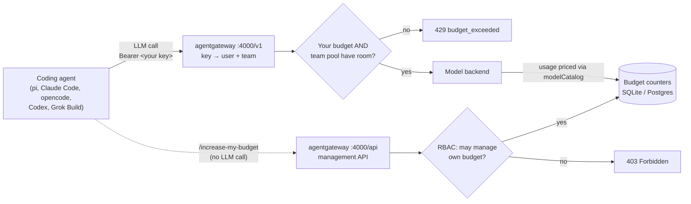

What borrowing does:

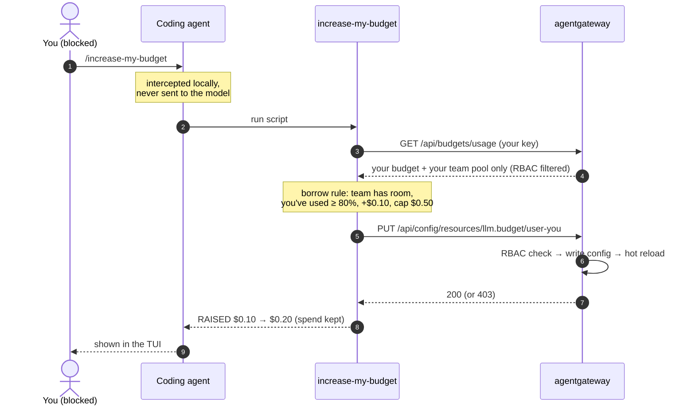

### What's native and what's in this repo

| Capability | Where it lives |
|---|---|
| Shared team pool, personal budgets, block when either runs out | agentgateway `llm.budgets` (native config) |
| Who's who (user and team from the API key) | agentgateway `config.standardAttributes` (native) |
| USD cost for any model, including self-hosted ones | agentgateway `config.modelCatalog` (native) |
| Reading remaining budget, raising a limit at runtime | agentgateway management API (native) |
| Who may raise which budget | agentgateway `rbac` (native) |
| **When** a raise is allowed, and the commands in your agent | **this repo** (`bin/` + one adapter per harness) |

No agentgateway code changes are needed. This was built and tested against the released **v2026.11.1** binary, and re-run with pi on macOS (Apple Silicon) against **v2026.11.1-patch.0**.

---

## Requirements

**Gateway:** Solo Enterprise agentgateway **v2026.11.1+**, standalone mode, with:
- `config.database` (SQLite or Postgres) so budget counters persist
- `llm.budgets` with one team pool per group and **one named budget per user** (`user-<name>`). A `user: "*"` wildcard budget can't be raised for one person.
- the UI and management API served on a gateway listener (`ui:` with `ui.policies.apiKey`), with `rbac` in `fine-grained` mode. Requests to the admin address skip RBAC, so bind `adminAddr` to `127.0.0.1`.

**Each user's machine:** `bash`, `curl`, `jq`, `awk`, plus the coding agent of their choice.

---

## 1. Gateway setup

[`gateway/config.example.yaml`](gateway/config.example.yaml) is a complete standalone config. These are the parts that matter:

```yaml
config:
  adminAddr: 127.0.0.1:15000               # admin port skips RBAC, so keep it local
  database: { url: sqlite:///var/lib/agentgateway/agw.db }
  standardAttributes: { user: 'apiKey.user', group: 'apiKey.group' }
  modelCatalog:                             # optional: price a self-hosted model
  - inline: { providers: { openai: { models: { your-model: { rates: { input: "3.00", output: "15.00" } } } } } }

gateways: { default: { port: 4000 } }      # LLM routes and the UI/API share one port

ui:
  policies:
    apiKey:                                 # users reach the management API with their normal key
      keys:
      - { key: sk-alice, metadata: { user: alice, group: engineering } }

rbac:
  mode: fine-grained
  policies:
  - name: engineering-borrowers
    subjects: [{ user: alice }, { user: bob }]
    grants:
    - { resource: llm.budget, access: view,   scope: { names: [pool-engineering] } }
    - { resource: llm.budget, access: view,   scope: { owner: self } }
    - { resource: llm.budget, access: manage, scope: { owner: self } }   # raise ONLY your own budget

llm:
  policies:
    apiKey:
      keys:
      - { key: sk-alice, metadata: { user: alice, group: engineering } }
  budgets:
  - { name: pool-engineering, subject: { group: engineering }, limit: { unit: USD, amount: 0.50 }, window: { rolling: 24h }, onBudgetExceeded: Block }
  - { name: user-alice,       subject: { user: alice },        limit: { unit: USD, amount: 0.10 }, window: { rolling: 24h }, onBudgetExceeded: Block }
```

- **`owner: self`** means the budget's `subject.user` is the caller. Team pools have no user, so nobody but an admin can change them.
- **Spend is kept on a raise.** Counters are keyed by budget name and subject. Changing only `amount` keeps the spend so far; changing `unit` or `window` resets it.

Check the RBAC rules with [`tests/rbac-test.sh`](tests/rbac-test.sh). It makes no LLM calls, but it does change some limits as admin (see "Testing"):

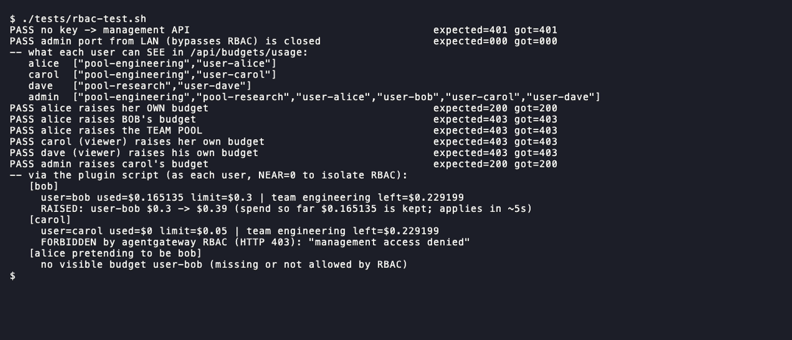

### Try it on your laptop (macOS Apple Silicon)

The example config uses Linux paths and a license file. For a local run, download the binary, compare the two checksums it prints, and rewrite those three lines:

```bash
cd ~/agentgateway-budget && mkdir -p local/bin local/data && cd local     # local/ is git-ignored
B=https://storage.googleapis.com/enterprise-agentgateway-standalone/v2026.11.1-patch.0/agentgateway-enterprise-darwin-arm64
curl -fsSL -o bin/agentgateway $B && curl -fsSL $B.sha256 && shasum -a 256 bin/agentgateway && chmod +x bin/agentgateway

sed -e '/^  license:$/,/^      file: .*$/d' \
    -e 's#sqlite:///var/lib/agentgateway/agw.db#sqlite://./data/agw.db#' \
    -e 's#http://YOUR-VLLM-HOST:8000/v1#http://your-backend:8000/v1#' \
    ../gateway/config.example.yaml > config.yaml

export ENTERPRISE_AGENTGATEWAY_LICENSE_KEY=<your-license-key>   # this exact name; AGENTGATEWAY_LICENSE_KEY is not read
./bin/agentgateway --validate-only -f config.yaml && ./bin/agentgateway -f config.yaml
```

The gateway, UI and management API are then on `http://localhost:4000` (UI at `/ui`, key `sk-admin`), and the model is called `dgx-qwen`. Run from `local/`, because the SQLite path is relative. Don't commit `local/config.yaml`: in file mode the gateway rewrites it on every raise.

---

## 2. Install the script (all harnesses)

```bash
git clone https://github.com/sebbycorp/agentgateway-budget ~/agentgateway-budget
ln -s ~/agentgateway-budget/bin/increase-my-budget ~/.local/bin/increase-my-budget   # any dir on your PATH

export AGW_URL=https://your-gateway:4000     # gateway base URL (a trailing /v1 is fine)
export AGW_API_KEY=sk-alice                  # your personal agentgateway key
increase-my-budget status
```

The script looks for the key in `AGW_KEY`, `AGW_API_KEY`, `ANTHROPIC_AUTH_TOKEN`, `OPENAI_API_KEY`, then pi's `agw-ent` provider, and uses the first one it finds. For the URL it checks `AGW_URL`, pi's `agw-ent` baseUrl, `ANTHROPIC_BASE_URL`, then `OPENAI_BASE_URL`. So in most harnesses it simply reuses the key you already configured.

> **Watch the order.** `OPENAI_API_KEY` and `ANTHROPIC_AUTH_TOKEN` come before pi's provider key. If your shell exports a real OpenAI or Anthropic key, the script sends *that* to the gateway and you get `cannot read …/api/budgets/usage` with a 401. Set `AGW_KEY` (or `AGW_API_KEY`) to be explicit. The pi extension does this for you.

---

## 3. Per-harness install

### pi

Requires pi 1.4+ (the npm package is now `@earendil-works/pi-coding-agent`; the old `@mariozechner/pi-coding-agent` stops at 0.73). The commands are registered as **native extension commands**: they run the script directly with no agent turn.

```bash
mkdir -p ~/.pi/agent/bin ~/.pi/agent/extensions
cp ~/agentgateway-budget/bin/increase-my-budget ~/.pi/agent/bin/
cp ~/agentgateway-budget/pi/agentgateway-budget.js ~/.pi/agent/extensions/
```

Add the gateway as a provider in `~/.pi/agent/models.json` (see [`pi/models.example.json`](pi/models.example.json)):

```json
"agw-ent": {
  "baseUrl": "https://your-gateway:4000/v1",
  "api": "openai-completions",
  "apiKey": "sk-alice",
  "models": [{ "id": "your-model" }]
}
```

Run `pi --provider agw-ent --model your-model`, then type `/my`:

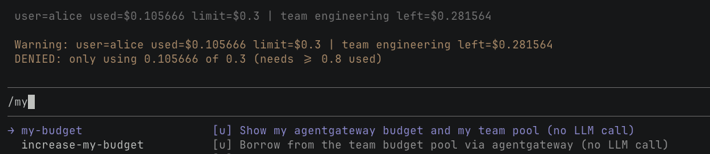

| Blocked by agentgateway | `/increase-my-budget` | Next prompt works |
|---|---|---|
| 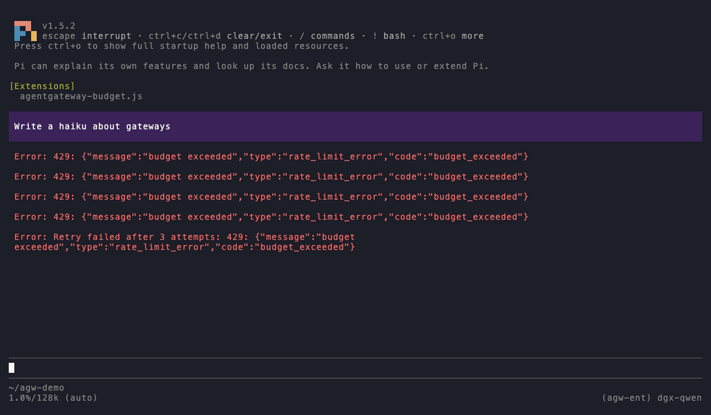 | 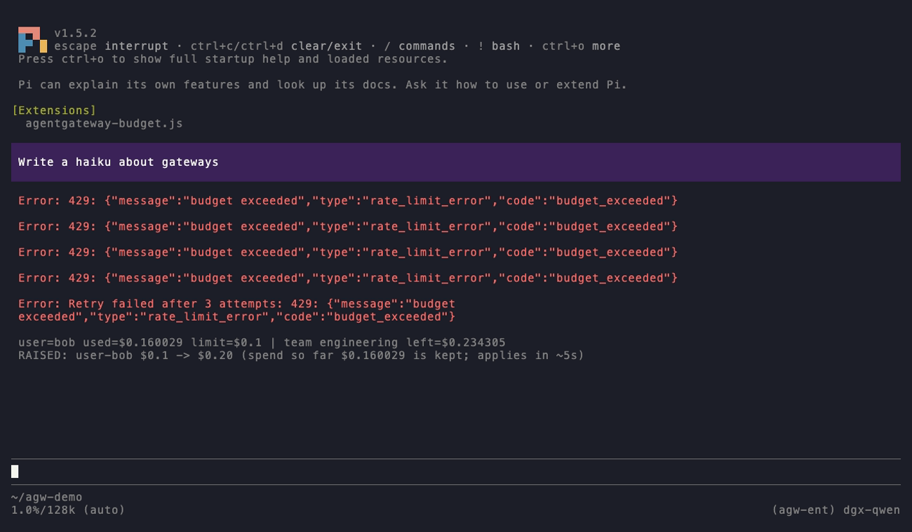 | 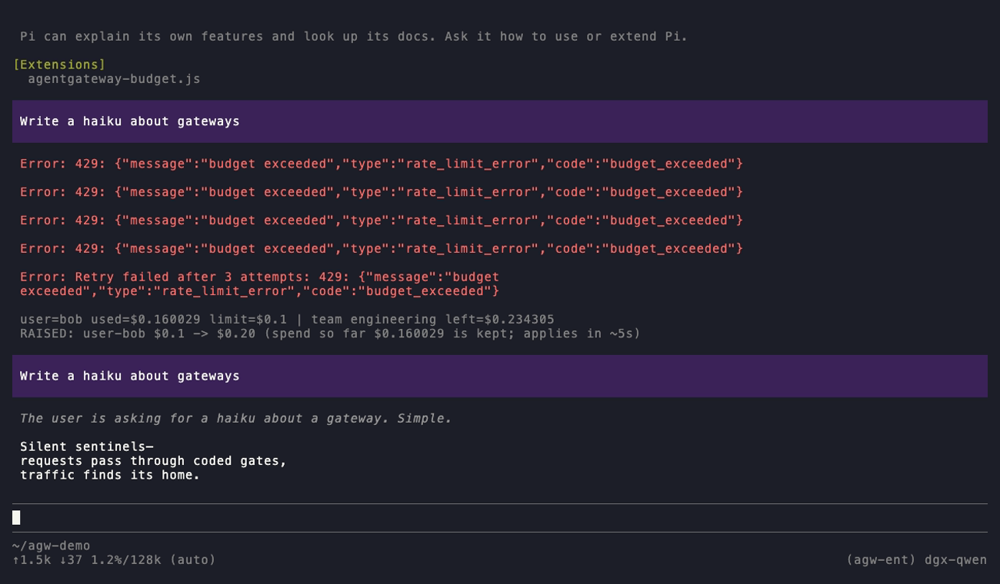 |

- The extension passes the `agw-ent` key and URL from `models.json` to the script, so an unrelated `OPENAI_API_KEY` in your shell can't be picked up instead. `AGW_KEY` / `AGW_API_KEY` still override it.
- On pi 0.73 the two commands work, but a prompt sent while you're blocked hangs in `pi -p` instead of printing the 429. The gateway's 429 carries a `retry-after` of several hours (until the window resets), which may be why. pi 1.5 prints the errors as in the screenshots.
- If another installed pi package fails to load, start pi with only this extension: `pi -ne -e ~/.pi/agent/extensions/agentgateway-budget.js --provider agw-ent --model your-model`.

> Don't use a pi **prompt template** for this. A template is an agent turn: the model may refuse to run it, the turn is charged to your budget, and it fails once you're blocked.

### Claude Code

The plugin is a `UserPromptSubmit` hook. It catches `/my-budget` and `/increase-my-budget`, runs the script, and blocks the prompt, so nothing reaches the model.

```bash
# point Claude Code at the gateway with your key
export ANTHROPIC_BASE_URL=https://your-gateway:4000
export ANTHROPIC_AUTH_TOKEN=sk-alice
```
```text
/plugin marketplace add sebbycorp/agentgateway-budget
/plugin install agentgateway-budget@agentgateway-budget
```
To try it without installing: `claude --plugin-dir ~/agentgateway-budget/claude-code`

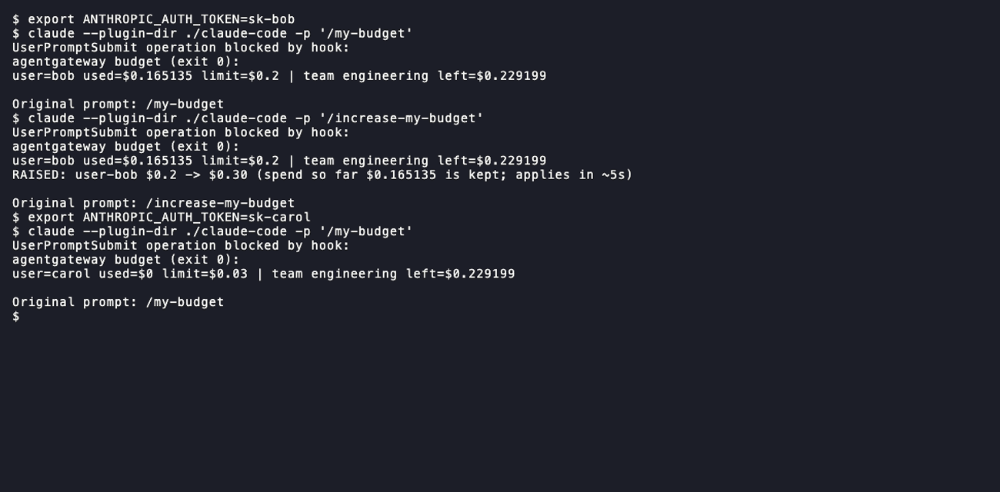

- Claude Code speaks the Anthropic Messages API. Put a Claude model behind agentgateway (Anthropic, Bedrock or Vertex). agentgateway can translate to OpenAI-style backends, but some self-hosted models reject Claude Code's request layout.
- Hook commands must quote `${CLAUDE_PLUGIN_ROOT}` (already done here), because paths with spaces otherwise break.

### opencode

Requires opencode 1.19+. A **TUI plugin** registers both commands in the `/` palette. They run locally and show the result in a dialog, with no session and no LLM call.

```bash
mkdir -p ~/.config/opencode/tui-plugins
cp ~/agentgateway-budget/opencode/tui-plugins/agentgateway-budget.js ~/.config/opencode/tui-plugins/
```
`~/.config/opencode/tui.json` (TUI plugins go here, **not** in `opencode.json`):
```json
{ "$schema": "https://opencode.ai/tui.json", "plugin": ["./tui-plugins/agentgateway-budget.js"] }
```
Add the provider in `~/.config/opencode/opencode.json` (see [`opencode/opencode.example.json`](opencode/opencode.example.json)), then `export AGW_API_KEY=… AGW_URL=…` and run `opencode`.

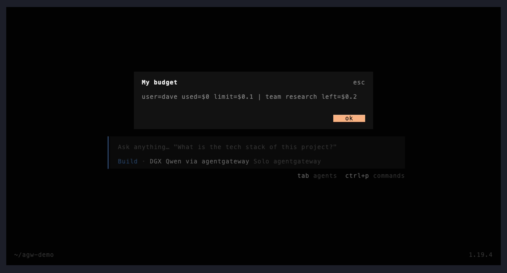

- Don't put the plugin in `plugins/`. That folder is for server plugins, and opencode will reject it there.
- `command/*.md` custom commands are prompts and **do** call the LLM, so they aren't used here.
- These commands exist only in the TUI, not in `opencode run`.

### Codex CLI

Requires Codex 0.170+. It uses a `UserPromptSubmit` hook. Codex rejects unknown `/slash` commands before any hook runs, so **type the commands without the slash**: `my-budget` and `increase-my-budget`.

`~/.codex/config.toml` (see [`codex/config.example.toml`](codex/config.example.toml)):
```toml
[model_providers.agw]
name = "Solo agentgateway"
base_url = "https://your-gateway:4000/v1"
env_key = "AGW_API_KEY"
wire_api = "responses"            # Codex only speaks the Responses API; agentgateway serves /v1/responses

[[hooks.UserPromptSubmit]]
[[hooks.UserPromptSubmit.hooks]]
type = "command"
command = "/home/you/agentgateway-budget/bin/agw-budget-hook"   # absolute path
timeout = 30
```
Run `export AGW_API_KEY=… AGW_URL=…` and then `codex -p agw` (with [`codex/agw.config.example.toml`](codex/agw.config.example.toml) saved as `~/.codex/agw.config.toml`).

Codex asks you to **trust the hook** once (or use `/hooks`). Hooks from managed config are trusted automatically, which suits fleet rollouts.

| One-time hook trust | `my-budget` / `increase-my-budget` |
|---|---|
| 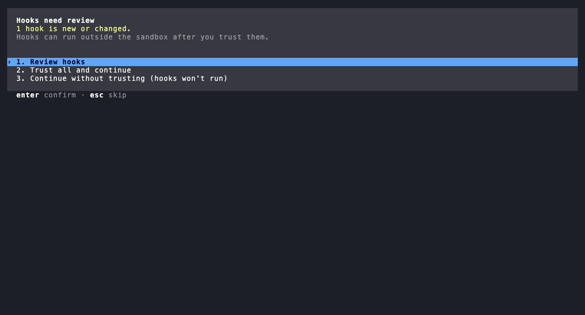 | 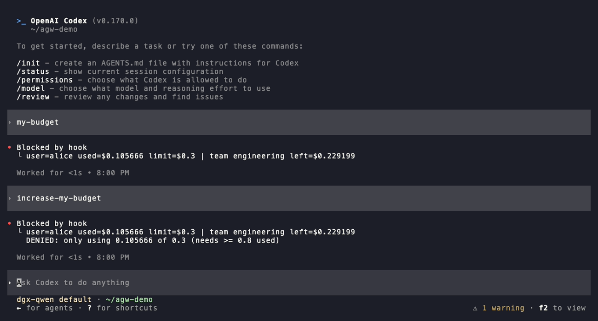 |

- `!increase-my-budget status` also works with no setup, but its output stays in the conversation context.

### Grok Build

Requires Grok Build 1.0.62+. It uses a global `UserPromptSubmit` hook, plus two skills that only exist to make the commands show up in the `/` menu.

```bash
mkdir -p ~/.grok/hooks ~/.grok/skills
sed "s#/ABSOLUTE/PATH/TO/agentgateway-budget#$HOME/agentgateway-budget#" \
  ~/agentgateway-budget/grok/hooks/agentgateway-budget.json > ~/.grok/hooks/agentgateway-budget.json
cp -R ~/agentgateway-budget/grok/skills/* ~/.grok/skills/
```
Add the model in `~/.grok/config.toml` (see [`grok/config.example.toml`](grok/config.example.toml)). Set `max_retries = 1` so Grok doesn't send the same request 9 times when you're over budget.

| `/` menu | `/my-budget` |
|---|---|
| 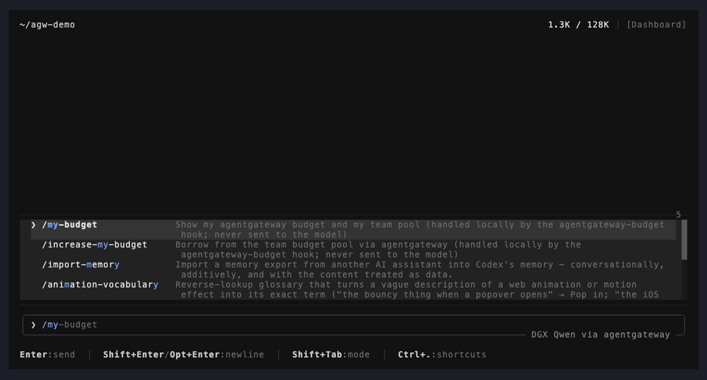 | 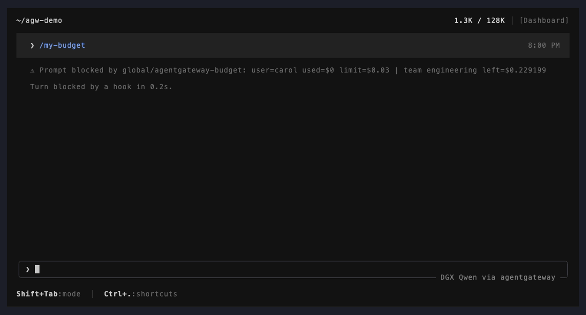 |

- The output only appears in the TUI; `grok -p` blocks the prompt but prints nothing.
- Grok also loads Claude Code hooks from `~/.claude/settings.json`. Don't register the hook in both places.

---

## Configuration

| Variable | Default | Meaning |
|---|---|---|
| `AGW_URL` | from harness config, else `http://localhost:4000` | Gateway base URL |
| `AGW_KEY` / `AGW_API_KEY` | from harness config | Your agentgateway key |
| `STEP` | `0.10` | USD added per borrow |
| `MAX` | `0.50` | Personal ceiling a borrow can reach |
| `NEAR` | `0.8` | Share of your limit you must have used before borrowing |
| `MIN_TEAM` | `0.10` | USD that must stay in the team pool |

Exit codes: `0` OK or raised, `1` setup error, `2` denied by the borrow rule, `3` forbidden by agentgateway RBAC.

## Testing

```bash
AGW_URL=https://your-gateway:4000 AGW_ADMIN_URL=http://your-gateway:15000 ./tests/rbac-test.sh
```

The test uses the example keys (`sk-alice`, `sk-bob`, `sk-carol`, `sk-dave`, `sk-admin`). It checks that a user can raise only their own budget, that viewers can change nothing, that admins can change anything, and that the admin port is closed. It changes some limits as admin, so run it against a test gateway.

## Caveats

- **RBAC controls *who* and *which budget*, not *how much*.** An allowed borrower could set any amount on their own budget through the API. The 80% rule and the cap live in the script. The team pool still blocks at the gateway, so a team can never overspend. To enforce amounts on the server, remove `manage` and have admins raise limits.
- **Overshoot.** Budgets are checked before a request and charged after it, so the last request can go past the limit.
- **Raises take a few seconds.** In file mode, agentgateway rewrites its config and hot-reloads it. Use hybrid mode with a database config store for multiple admins or replicas.
- **Windows are aligned to UTC.** A `24h` window resets at midnight UTC.

## Layout

```
bin/increase-my-budget        the budget script (status | borrow)
bin/agw-budget-hook           UserPromptSubmit hook for Codex and Grok Build
pi/                           pi extension + provider example
claude-code/                  Claude Code plugin (marketplace at .claude-plugin/)
opencode/                     opencode TUI plugin + config examples
codex/                        Codex config example (provider + hook)
grok/                         Grok Build config, hook, autocomplete skills
gateway/config.example.yaml   agentgateway Enterprise standalone config
tests/rbac-test.sh            RBAC checks (no LLM calls)
```

Screenshots are real sessions against a lab gateway (agentgateway Enterprise v2026.11.1, local Qwen model on a DGX Spark).
